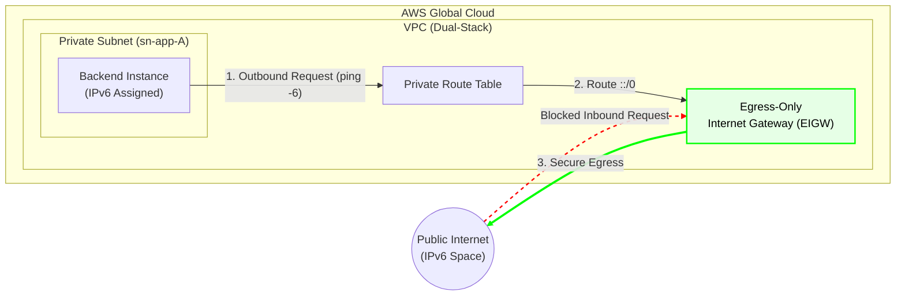

# Secure IPv6 Egress Routing via Egress-Only Internet Gateway (EIGW)

## 📖 Enterprise Scenario & Business Context
As enterprise environments modernize their network stacks, there is a strong shift towards adopting IPv6. In these modern architectures, backend microservices running in private subnets are often assigned globally routable IPv6 addresses. 

However, these isolated backend systems still require outbound internet access to fetch API updates, download packages, or connect to third-party integrations. 
* **The Problem:** Using a traditional NAT Gateway is not possible for IPv6. Additionally, attaching a standard Internet Gateway (IGW) to the subnet would expose the backend instances to inbound traffic from the public internet, violating Zero-Trust and security compliance.
* **The Solution:** Architecting an **Egress-Only Internet Gateway (EIGW)** to allow outbound IPv6 traffic while strictly blocking all inbound connections, maintaining full security isolation at zero additional cost.

---

## 🏗️ Architecture & Traffic Flow Diagram
*(The following diagram renders automatically on GitHub)*

---

## ⚙️ Technical Implementation Sequence

### Phase 1: Infrastructure Provisioning
1. **Network Preparation (Dual-Stack VPC):** Provisioned a VPC and enabled IPv6 CIDR block generation. Assigned an IPv6 CIDR to the private subnet (`sn-app-A`).
2. **EIGW Instantiation:** Created an Egress-Only Internet Gateway (`aem-vpc1-egw`) and attached it to the VPC.
3. **Route Table Modification:** Updated the Private Route Table (`rtb-046fdf88472fb02cb`) to direct all IPv6 traffic (`::/0`) to the newly created EIGW.

### Phase 2: Traffic Validation (Data Plane)
1. **Initial Isolation Check (Failure):**
  - Attempted to ping Google's IPv6 address (`ping -6 ipv6.google.com`) before adding the EIGW route.
  - Result: 100% packet loss, validating that the subnet was securely isolated.
2. **Egress Success Validation:**
  - After updating the Route Table with the EIGW, the ping was executed again.
  - Result: 0% packet loss (successful outbound connectivity).
3. **Application Success:**
  - The isolated backend service successfully reached out to external APIs via IPv6 to fetch live data updates, rendering the application fully functional on the frontend.

---

## 🚀 Business Impact
* **Zero-Trust Security Achieved:** Backend services can securely download updates from the internet while remaining completely invisible and inaccessible to inbound internet threats.
* **Cost Optimization:** Unlike IPv4 NAT Gateways which incur hourly fees and data processing charges, the Egress-Only Internet Gateway is 100% free of charge, drastically reducing cloud networking bills.
* **Modernization:** Positioned the infrastructure for future-proof scalability by natively supporting IPv6 traffic flows.