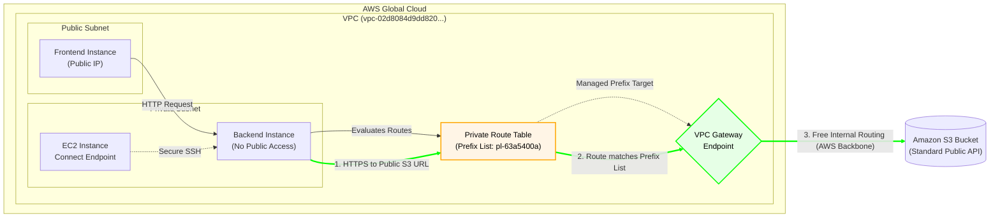

# Cost-Optimized Amazon S3 Access via VPC Gateway Endpoint

## 📖 Enterprise Scenario & Business Context
In data-heavy enterprise environments, isolated backend systems (such as database backup instances or big data processors) often need to transfer terabytes of data to and from Amazon S3. 

While **VPC Interface Endpoints (PrivateLink)** provide excellent granular security, they incur hourly charges and per-GB data processing fees. For high-bandwidth workloads, these costs can spiral out of control. Furthermore, using NAT Gateways for this traffic is both a security risk and highly expensive.

**The Solution:** Implementing **AWS VPC Gateway Endpoints** for Amazon S3. This architecture optimizes cloud spend by leveraging AWS Route Tables and Managed Prefix Lists to securely route S3 traffic over the internal AWS backbone at **zero additional cost**, without requiring any code changes in the backend applications.

---

## 🏗️ Architecture & Traffic Flow Diagram

*(The following diagram renders automatically on GitHub)*

---

## ⚙️ Technical Implementation Sequence

### Phase 1: Infrastructure Provisioning (Control Plane)
1. **Network Isolation:** Provisioned a VPC with isolated private subnets. No NAT Gateways or Internet Gateways were attached to these subnets.
2. **Access Management:** Deployed an EC2 Instance Connect Endpoint (EICE) for secure, agentless access.
3. **Endpoint Instantiation (Gateway Type):** 
   - Provisioned a VPC Endpoint for S3 (`com.amazonaws.us-east-1.s3`) and explicitly selected the **Gateway** type instead of Interface.
4. **Route Table Injection:** 
   - Associated the Gateway Endpoint with the Private Subnets' Route Table (`rtb-046fdf88472fb02cb`).
   - AWS automatically injected a Managed Prefix List (`pl-63a5400a`) into the Route Table, targeting the VPC Endpoint (`vpce-08748cb19cd090ada`).

### Phase 2: Traffic Flow & Validation (Data Plane)
1. **Transparent Application Execution:** 
   - Unlike Interface Endpoints that require explicit DNS overrides, the backend application (`install.sh`) was executed using the **Standard Public URL** for S3 (`https://learn-cloudlee-labs.s3.us-east-1.amazonaws.com/...`).
2. **Traffic Routing Engine:**
   - The backend instance initiated the HTTPS request.
   - The VPC Router evaluated the destination IP against the Route Table.
   - The IP matched the AWS Managed Prefix List (`pl-63a5400a`) for S3.
3. **Free Internal Transit:**
   - The traffic was seamlessly redirected to the Gateway Endpoint and traversed the AWS Global Backbone securely to S3.
4. **Application Success:** 
   - The backend successfully fetched the product catalogue at maximum throughput, demonstrating a fully functional, isolated, and cost-optimized system.

---

## 🚀 Business Impact (FinOps Focus)
* **100% Cost Elimination on S3 Egress:** Completely bypassed NAT Gateway data processing fees ($0.045/GB) and Interface Endpoint processing fees ($0.01/GB). Gateway Endpoints are entirely free.
* **Transparent Operations:** Development teams did not need to modify application code, SDKs, or environmental variables. Standard S3 URIs worked out of the box.
* **Uncapped Bandwidth:** Achieved maximum possible throughput for bulk data transfers, as Gateway Endpoints are highly available Route Table targets, not ENIs bound by instance-level network limits.