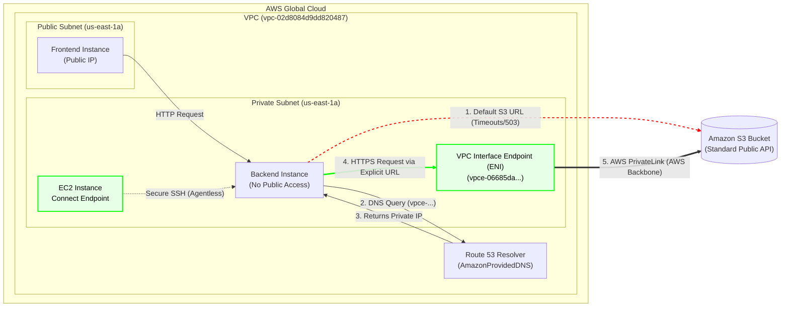

# Secure Amazon S3 Access via VPC Interface Endpoint (AWS PrivateLink)

## 📖 Enterprise Scenario & Business Context
In strictly regulated enterprise environments (e.g., Telecom, FinTech), backend microservices (running on EC2 or EKS) must reside in completely isolated private subnets. For security compliance, these subnets cannot have Internet Gateways (IGW) or NAT Gateways attached.

However, these backend services often require access to Amazon S3 to fetch configuration artifacts (e.g., `products.json`, initialization scripts). Routing this traffic over the public internet is a security violation, and deploying NAT Gateways solely for this purpose incurs heavy hourly and data-processing costs.

**The Solution:** Implementing **AWS PrivateLink (VPC Interface Endpoints)** with **Explicit Endpoint Routing** to maintain a Zero-Trust architecture, optimize costs, and prevent VPC-wide DNS conflicts.

## 🏗️ Architecture & Traffic Flow Diagram

*(The following diagram renders automatically on GitHub)*

## ⚙️ Technical Implementation Sequence

### Phase 1: Infrastructure Provisioning (Control Plane)
1. **Network Isolation:** Provisioned a VPC with isolated private subnets across multiple Availability Zones (`us-east-1a`, `us-east-1b`, `us-east-1c`).
2. **Access Management:** Deployed an EC2 Instance Connect Endpoint (EICE) to allow secure, agentless SSH access to the private backend instances, eliminating the need for vulnerable Bastion hosts.
3. **Endpoint Security Group:** Created a dedicated Security Group (`ENDPOINTS-InstanceSecurityGroup`) allowing inbound HTTPS (443) traffic strictly from the backend instances.
4. **Endpoint Instantiation:** Provisioned a VPC Interface Endpoint for S3 (`com.amazonaws.us-east-1.s3`) across the private subnets.
5. **Architectural Decision (No Private DNS):** Intentionally disabled Private DNS for the endpoint. In multi-tenant enterprise VPCs, enabling Private DNS overrides the default S3 resolution for the entire VPC. By keeping it disabled, we maintained granular routing control, ensuring only specific, authorized microservices utilize the PrivateLink.

### Phase 2: Traffic Flow & Validation (Data Plane)
1. **Isolation Validation (The Initial Failure):**
   - Attempted to fetch initialization artifacts (`aem-backend.zip`) using the standard S3 public URL.
   - Result: `Connection timed out`. This successfully validated that the private instance was strictly isolated (Zero-Trust) with no outbound internet access.
2. **Explicit Application Configuration:**
   - The backend service was configured to explicitly target the Endpoint-specific DNS name (e.g., `bucket.vpce-06685da1625012a2c-vgak8zk4.s3.us-east-1.vpce.amazonaws.com`) instead of the public S3 URL.
3. **Traffic Execution:**
   - The application initiated an HTTPS request to the VPCE-specific URL.
   - The VPC Route 53 Resolver resolved this specific URL to the Private IPs of the Endpoint's ENIs within the local subnet.
   - Traffic was securely routed across the AWS Global Backbone via PrivateLink to the S3 bucket.
4. **Application Success:**
   - The backend successfully fetched the artifacts at high speeds, initialized the service, and successfully served the configuration data (`products.json`) to the public-facing frontend.

## 🚀 Business Impact
- **100% Security Compliance:** Maintained a strict Zero-Trust network topology. No sensitive internal traffic traverses the public internet.
- **Cost Optimization:** Completely eliminated the need for NAT Gateways, avoiding both the hourly provisioning charges and the heavy per-GB data processing fees associated with NAT traffic.
- **Granular Network Control:** By utilizing explicit endpoint URLs instead of VPC-wide Private DNS, we prevented accidental routing overrides for other unrelated workloads within the same VPC.