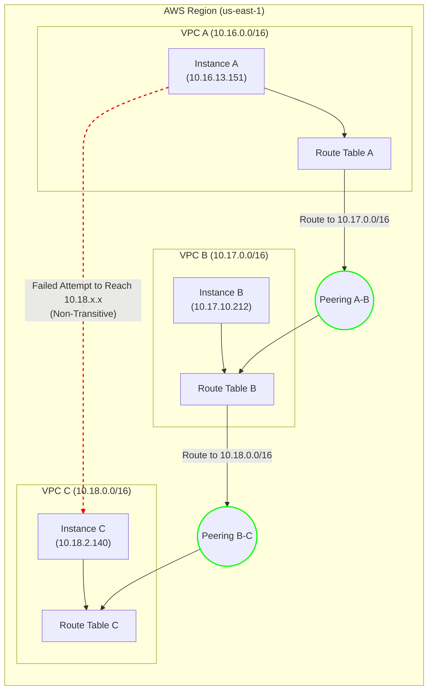

# Secure Inter-VPC Connectivity & Non-Transitive Routing

## 📖 Enterprise Scenario & Business Context
In large-scale enterprise environments, network architecture often dictates the use of multiple Virtual Private Clouds (VPCs) to segregate environments (e.g., Development, Staging, Production, or Shared Services). 

When services in isolated VPCs need to communicate (e.g., a frontend app in VPCA needing data from a database in VPCB), routing that traffic over the public internet is a critical security violation. 

**The Challenge:** Establishing secure, private communication between isolated VPCs while navigating the strict rules of AWS routing, specifically the lack of transitive peering.

**The Solution:** Implementing direct **AWS VPC Peering Connections** and meticulously configuring Route Tables, Security Groups, and Network ACLs to facilitate secure, point-to-point communication.

---

## 🏗️ Architecture & Traffic Flow Diagram

*(The following diagram renders automatically on GitHub)*

---

## ⚙️ Technical Implementation Sequence

### Phase 1: Infrastructure & Initial State
1. **Multi-VPC Provisioning:** Created three distinct VPCs (VPCA, VPCB, VPCC) with non-overlapping CIDR blocks to prevent routing conflicts.
2. **Instance Deployment:** Deployed Amazon Linux EC2 instances in private subnets across all three VPCs.
3. **Initial Peering:** Established a peering connection solely between VPCB and VPCC.

### Phase 2: Validating Constraints (The Failure)
1. **Testing Transitivity:** Attempted to ping Instance C (in VPCC) from Instance A (in VPCA).
2. **Result:** The connection failed (100% packet loss). This successfully demonstrated that AWS VPC Peering is **Non-Transitive**. Even though VPCB is peered with VPCC, VPCA cannot use VPCB as a transit hub to reach VPCC.

### Phase 3: Implementing the Solution
1. **Direct Peering Connection:** Created a new, direct VPC Peering request from VPCA (Requester) to VPCB (Accepter).
2. **Acceptance:** Accepted the peering request, changing its status to `Active`.
3. **Route Table Configuration:**
   - Updated VPCA's Route Table to direct traffic destined for `10.17.0.0/16` (VPCB) to the new Peering Connection object.
   - Updated VPCB's Route Table to direct return traffic for `10.16.0.0/16` (VPCA) back through the same Peering Connection.
4. **Security Hardening:** Configured Security Groups and Network ACLs to allow specific ICMP and SSH traffic only from the peered CIDR blocks.

### Phase 4: Final Validation
1. **Connectivity Test:** Executed a ping from Instance A to Instance B.
2. **Result:** Success (0% packet loss). The explicit peering connection and routing configuration enabled secure, private communication across the AWS backbone.

---

## 🚀 Business Impact
* **Enhanced Security:** Sensitive internal traffic flows securely across the AWS global network, completely bypassing the public internet.
* **Cost Efficiency:** Reduces costs associated with routing traffic through external gateways or VPNs.
* **Architectural Clarity:** Demonstrated a deep understanding of AWS networking limitations (non-transitive routing) and the precise configuration required to overcome them securely.